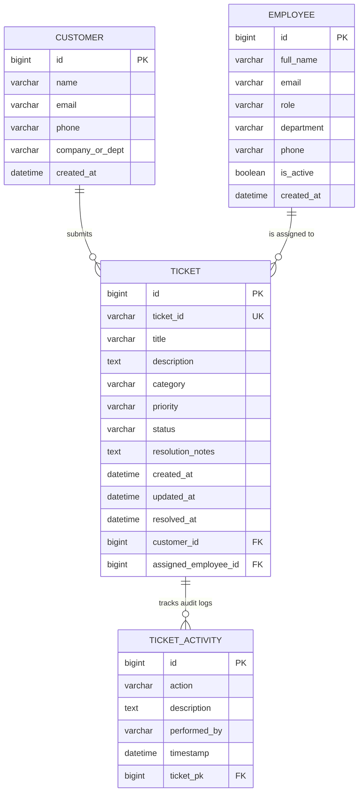

# Customer Support Ticket Management System

A production-ready, centralized web-based application designed to streamline, automate, and monitor the entire lifecycle of customer service queries, incident requests, and support tickets.

Built with **Java 17**, **Spring Boot 3**, **MySQL 8**, **Spring Data JPA**, **Thymeleaf**, **Bootstrap 5**, and **Chart.js**.

---

## 📌 Problem Statement Overview

### 1. Background
In many organizations, customer complaints and service requests are handled manually through emails, phone calls, and spreadsheets. Managing a large number of customer queries using these methods leads to delays, poor communication, difficulty tracking complaints, and sometimes the loss of important customer requests.

### 2. Problem
There is a need for a centralized web-based application that simplifies and automates the customer support process. The manual handling of customer issues makes it difficult to track the status, assign responsibilities, and ensure timely resolution. It also leads to poor record management and lack of visibility.

### 3. Need for the System
The Customer Support Ticket Management System is designed to overcome these challenges by providing a robust platform where customer issues can be recorded, tracked, assigned, and resolved efficiently.

### 4. Objectives
- Provide a user-friendly platform to create and manage support tickets.
- Store customer and complaint information in a centralized database.
- Allow employees to track and update ticket status in real time.
- Reduce manual work and improve operational efficiency.
- Ensure better communication and faster resolution of customer issues.

### 5. System Features
- **Ticket Creation**: Create support tickets with customer details and comprehensive issue descriptions.
- **Ticket Assignment**: Assign tickets to specialized support employees.
- **Status Workflow**: Update ticket status through lifecycle stages (`Open`, `In Progress`, `Resolved`, `Closed`).
- **Priority Levels**: Set priority levels (`Low`, `Medium`, `High`) with clear visual badge indicators.
- **Ticket Search & Tracking**: Search and track tickets using unique Ticket IDs (e.g., `TKT-1001`) or customer email.
- **Analytics Dashboard**: Interactive dashboard displaying key KPIs, workload distribution, and dynamic charts.

---

## 🛠️ Technologies Used

| Technology | Role |
| :--- | :--- |
| **Java 17 (LTS)** | Core programming language & runtime |
| **Spring Boot 3.2.5** | Modern backend micro-framework & MVC architecture |
| **Spring Data JPA & Hibernate** | Object-Relational Mapping (ORM) and repository persistence |
| **MySQL 8.0** | Centralized relational database |
| **Thymeleaf** | Server-side HTML template rendering engine |
| **Bootstrap 5.3 & Icons** | Responsive UI styling, cards, modal dialogs, and navigation |
| **Chart.js 4.4** | Interactive visual charts for ticket analytics |

---

## 🏛️ System Architecture & Entity Model



---

## 🚀 Quick Start Guide

### 1. Prerequisites
- **Java 17+** (Pre-configured at `C:\Users\prasu\.tools\jdk-17`)
- **Maven 3.9+** (Pre-configured at `C:\Users\prasu\.tools\maven`)
- **MySQL Server 8.0** running on `localhost:3306`

### 2. Database Configuration
The database `customersupport_db` has been pre-created. Settings in `src/main/resources/application.properties`:

```properties
spring.datasource.url=jdbc:mysql://localhost:3306/customersupport_db?createDatabaseIfNotExist=true&useSSL=false&serverTimezone=UTC&allowPublicKeyRetrieval=true
spring.datasource.username=root
spring.datasource.password=2004
spring.datasource.driver-class-name=com.mysql.cj.jdbc.Driver
spring.jpa.hibernate.ddl-auto=update
server.port=8082
```

### 3. Launching the Application
Double-click:
```cmd
START_APP.bat
```
Or run from command prompt:
```cmd
mvn spring-boot:run
```

Once started, open your web browser at:
👉 **[http://localhost:8082](http://localhost:8082)** (or double-click `OPEN_BROWSER.bat`)

---

## 🧭 Application Modules & URLs

| URL Path | Feature Description |
| :--- | :--- |
| **`/` or `/dashboard`** | Support Dashboard with KPIs, Charts, Recent Tickets, and Workload |
| **`/tickets`** | Ticket Management list with multi-parameter filter (keyword, status, priority, category, agent) |
| **`/tickets/new`** | Customer Ticket creation portal |
| **`/tickets/{id}`** | Ticket Detail view with action modals (Status, Assign, Priority) and activity timeline |
| **`/tickets/{id}/edit`**| Edit ticket attributes and resolution notes |
| **`/employees`** | Support Team roster & active ticket workload balancing |
| **`/employees/new`** | Add new support agent |
| **`/track`** | Customer self-service ticket tracker (Search by `Ticket ID` or `Email`) |
| **`/api/dashboard/stats`** | REST API endpoint returning live JSON statistics |
| **`/api/tickets/{ticketId}`** | REST API endpoint fetching individual ticket by public ID |

---

## 🧪 Testing

To run the automated test suite:
```cmd
RUN_TESTS.bat
```
Or execute:
```cmd
mvn test
```

---

## 📦 Building Standalone Executable JAR

To package the application into a standalone executable JAR:
```cmd
BUILD_JAR.bat
```
The output file will be generated at:
`target/ticket-management-system-1.0.0.jar`
